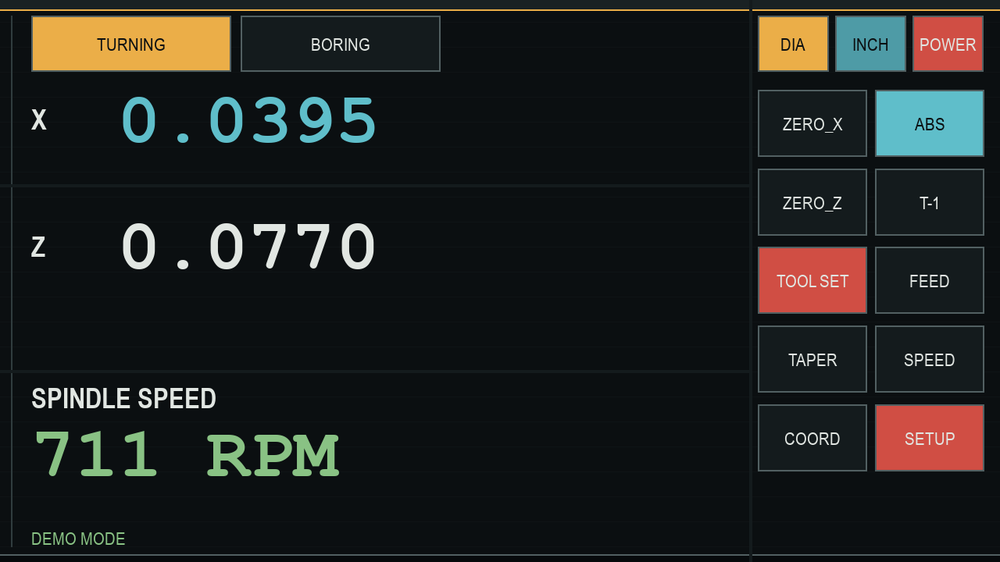
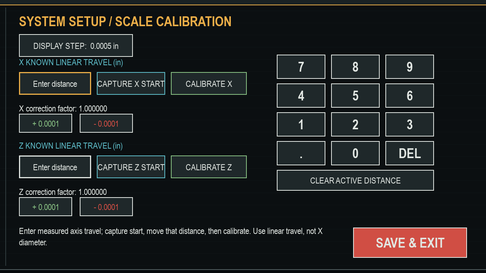

# Lathe DRO: Dell Latitude 7275 and Raspberry Pi Pico 2

> **Machine compatibility:** The main configuration is tailored to a South Bend
> 10K lathe with a Model A quick-change gearbox. The Raspberry Pi version is a
> general-purpose DRO host for any lathe once its scales, spindle sensor, and
> calibration are configured. Verify machine-specific FEED and SPEED reference
> values before relying on them.

The Dell runs the Pygame touchscreen readout; the Pico 2 reads the scales and spindle sensor and streams counts over USB serial. After startup, choose either the South Bend lathe or the Grizzly G0704 mill. The mill DRO includes independent absolute/incremental zeroes, inch/mm units, per-axis zero/half/preset, direction reversal, separate persistent X/Y/Z calibration, and advanced tools for PCD, linear and grid hole patterns, cutter-radius offsets, arithmetic/trigonometry/slope calculations, and eight saved sub-datums.
The machine-selection screen uses `assets/south_bend_badge.png` for the lathe button; keep this image beside the app.

The Raspberry Pi host app in [`raspberry_pi_dro/`](raspberry_pi_dro/README.md) now provides the same lathe and mill modes and DRO tools on Raspberry Pi OS Desktop. It uses the same five-scale Pico 2 serial data, with Pi-specific installation and autostart instructions in that guide.

## Screenshots

Captured in demo mode; displayed readings are simulated, not live measurements.





## Dell: Ubuntu Server

Pygame needs a local graphical session. A headless SSH session alone cannot display the DRO. If the Server installation has no desktop, install a lightweight X session and touch input support:

```bash
sudo apt update
sudo apt install xserver-xorg xserver-xorg-input-libinput xinit openbox python3 python3-venv python3-pip
```

From the Dell's local console, create the Python environment and install the app dependencies:

```bash
python3 -m venv .venv
.venv/bin/pip install -r requirements.txt
chmod +x run_dro.sh build_pico2.sh
```

Add the login user to the serial-device group, then log out and back in:

```bash
sudo usermod -aG dialout "$USER"
```

If you installed Ubuntu Server without a display manager, start the kiosk session from a local text console:

```bash
cd /path/to/lathe-dro-project
printf 'exec %s/run_dro.sh\n' "$PWD" > ~/.xinitrc
startx
```

The DRO starts fullscreen by default on Linux. With an existing desktop, run `./run_dro.sh` from its terminal instead.

If the Pico is not auto-detected, pass its device path:

```bash
./run_dro.sh --port /dev/ttyACM0
```

For a windowed demo without the Pico:

```bash
./run_dro.sh --demo --windowed
```

## DRO Tools

- `FEED` looks up the South Bend Model A chart's 70 thread pitches (4–480 TPI) and displays the 40-tooth stud gear, left-hand tumbler position (A–G), and right-hand selector position (1–10).
- `SPEED` estimates spindle RPM from work diameter and surface speed. Editable HSS starting presets are mild steel (80 SFM), aluminum (200 SFM), stainless steel (50 SFM), and cast iron (60 SFM). These are approximate starting points; the result is advisory only and does not control the spindle. Choose a safe speed available on the machine and verify it for the actual tool, material, workholding, and setup.
- `TAPER` calculates the compound-rest half-angle from large diameter, small diameter, and axial length.
- Lathe `COORD` calculates midpoint, shoulder distance, or a bolt circle. Mill `MACROS` provides centered PCD, angled linear arrays, rotated grids (up to 24 holes), midpoint/distance, straight-edge cutter-radius offsets, arithmetic, degree-based trigonometry, rise/run slope, and eight persistent sub-datums. Pattern coordinates are absolute within the active work datum. These tools display calculations only; they do not move or control the mill. Sub-datums store Pico encoder counts and must be re-established after the Pico resets its counters.
- `TOOL SET` stores offsets in `tool_offsets.json` beside the Python app. Capture T-1 as the master; for T-2 through T-9 you can capture both axes or enter a signed X offset relative to T-1 with the on-screen keypad. Manual X entry uses the current INCH/MM and RAD/DIA settings and preserves any captured Z offset.
- `BORING` accepts the initial drilled diameter, captures the live X position at that starting bore size, and adds twice the calibrated radial X travel to display the estimated current bore diameter. Choose whether X+ or X- increases diameter to match the installed scale. Capture is disabled in demo mode.
- `POWER` asks for confirmation, then requests Ubuntu power-off. It does not stop the lathe. On Ubuntu, grant only the required command with `sudo visudo -f /etc/sudoers.d/lathe-dro-poweroff` and add `YOUR_USERNAME ALL=(root) NOPASSWD: /usr/bin/systemctl poweroff`.

For BORING, enter the measured starting hole diameter, position the boring tool at the starting bore wall, and capture X. Bore outward to track the estimated diameter. Select the X direction that makes the estimate increase as the tool moves outward, and verify finished sizes with a bore gauge; this is an estimate from scale travel, not a direct bore measurement. The baseline carries across tool changes only when both tools have saved X offsets; otherwise capture a new start position after changing tools.

These calculators are references only; they do not control spindle, carriage, or cross-slide motion. They do not replace checking the machine's chart, tool manufacturer's guidance, or a test cut. Calibrate the scale counts per inch and verify the spindle RPM on the actual lathe before relying on displayed measurements or speed estimates.

The SPEED screen uses these operator-supplied spindle RPMs:

| Step | Belt, low | Back gear, low | Belt, high | Back gear, high* |
| --- | ---: | ---: | ---: | ---: |
| 1 (largest spindle pulley) | 240 | 50 | 460 | 90 |
| 2 (middle spindle pulley) | 410 | 78 | 780 | 155 |
| 3 (smallest spindle pulley) | 715 | 135 | 1365 | 265 |

The high-range back-gear column was marked with an asterisk in the supplied table; confirm its footnote before using those values. The screen chooses the highest listed speed not exceeding the target, and reports when the target is below the selected range.

## Pico 2 Firmware

Install the ARM compiler and build tools:

```bash
sudo apt install cmake ninja-build gcc-arm-none-eabi git python3
```

If `pico-sdk` is not already in the project directory, clone the SDK version used by this project, then initialize its dependencies:

```bash
git clone --branch 2.3.1 --recurse-submodules https://github.com/raspberrypi/pico-sdk.git pico-sdk
git -C pico-sdk submodule update --init --recursive
```

Build the Pico 2 image:

```bash
./build_pico2.sh
```

The UF2 image is written to `build-pico2/lathe_dro_pico.uf2`. Hold BOOTSEL while connecting the Pico 2 over USB, then copy the UF2 file to its mounted boot drive.
The firmware reads five scales independently: lathe X/Z and mill X/Y/Z. Its serial packet carries separate lathe (`LX`, `LZ`) and mill (`MX`, `MY`, `MZ`) counts; older UF2 images do not support the separate machine inputs.

On Windows, rebuild from PowerShell with `powershell.exe -NoProfile -ExecutionPolicy Bypass -File .\build_pico2.ps1`. The process-scoped policy handles Windows installations that block local scripts by default. The script adds Git for Windows' MinGW runtime DLL directory to the build process so the Pico SDK's `picotool` can start; neither setting changes the system-wide PATH or execution policy.

## Wiring and Calibration

- Mill X scale channels A/B use GPIO 2/3.
- Mill Z scale channels A/B use GPIO 4/5.
- Mill Y scale channels A/B use GPIO 6/7.
- The spindle sensor output uses GPIO 8.
- Lathe X scale channels A/B use GPIO 9/10; lathe Z channels A/B use GPIO 11/12.
- All five scale pairs have independent GPIO inputs and can remain connected. The firmware reads them continuously; choosing a machine selects the corresponding counts for its DRO. Power off before making wiring changes.
- In the mill DRO, `ZERO` sets the selected axis to zero, `HALF` halves its displayed coordinate (useful for finding center), `SET` presets a coordinate, and `DIR` reverses that axis's displayed direction. `MACROS` opens the milling geometry tools. Pattern coordinates are absolute within the active work datum. Cutter compensation reports a tool-center point for a straight edge only; it does not calculate corner joins or control machine motion. Mill unit mode, axis directions, calibration, and saved sub-datums are independent of the lathe. Calibration uses `mill_scale_calibration.json`; named sub-datums use `mill_sub_datums.json`. Re-establish the machine reference after a Pico reboot because encoder counts restart at zero.
- Keep Pico GPIO signals within 0-3.3 V; level-shift or condition scale and sensor outputs as required.
- The DRO currently assumes 25,400 scale counts per inch and four spindle sensor pulses per revolution. Verify these values against the installed scales and sensor before relying on measurements.
- To calibrate an axis, select INCH/MM on the main screen, open `SETUP`, enter a known linear travel in that unit, and click `CAPTURE <axis> START` at the starting point. Move that axis by the measured distance, then click `CALIBRATE <axis>`. Use a long, trusted measurement and approach both endpoints consistently to reduce measurement error and backlash.
- Calibration uses raw count change, independent of zero and RAD/DIA display modes. For X, enter physical cross-slide (radial) travel, not the doubled diameter display. The correction factors and fine adjustments persist in `scale_calibration.json` beside the Python app; scale count convention and accuracy still need verification against the installed hardware.
- Tool touch-offs are stored in `tool_offsets.json` beside the Python app. Capture T-1 at the reference datum, then capture each other tool at the same datum.